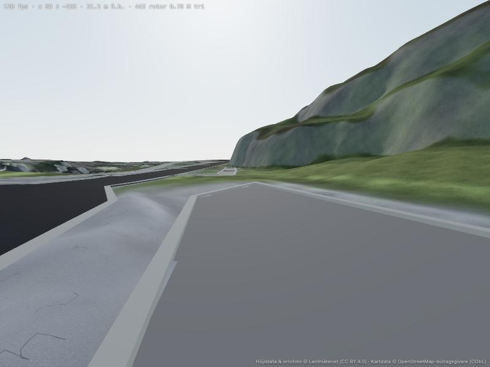
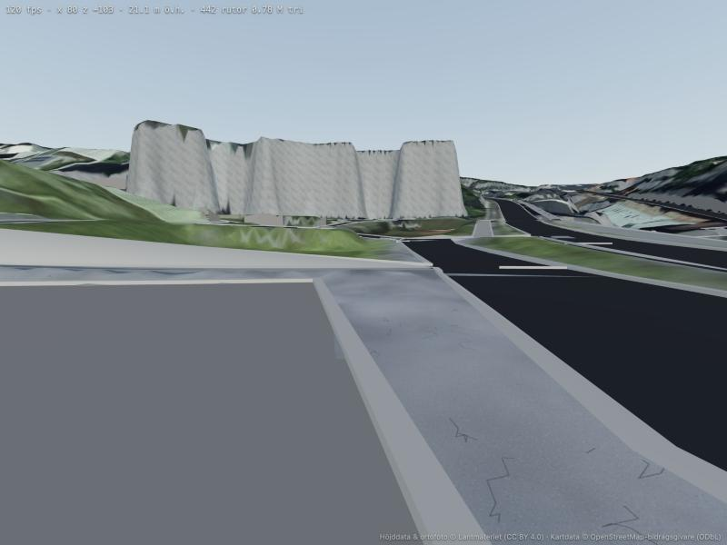
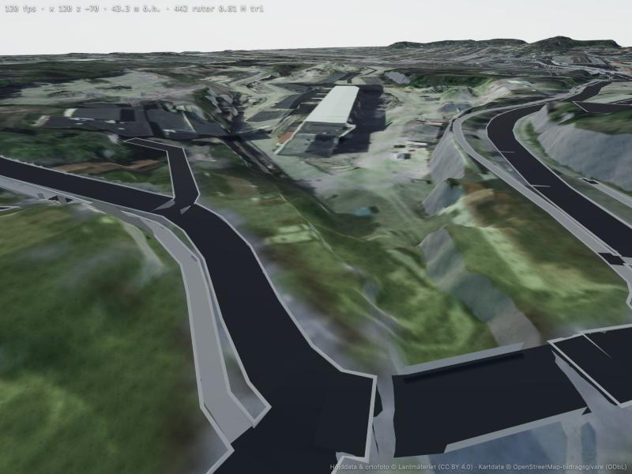
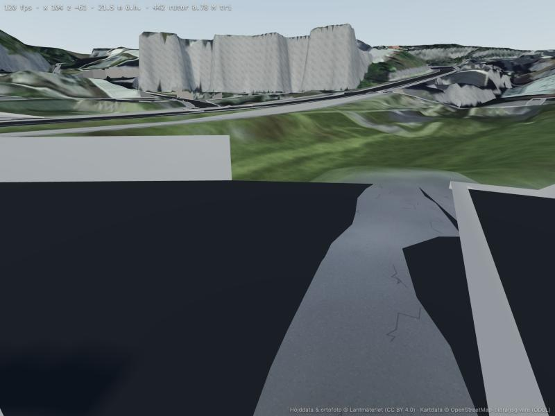

# Bevis 2026-10-21: Mölndals bro + vägnätet runt Gamla torget, byggt offline

Första körningen av metoden i `VISION.md` §3b: en offline-modell i Python (`tools/v2model/`)
som bygger vägnätet som geometri ur OSM + LiDAR, med en global profil-lösare, terräng-
konformering och mätgrindar. Inget är lappat i webbläsaren. Webbläsaren renderar bara.

Område: x −680…260, z −260…160 (Gamla torget, Forsebron, Mölndals bro, rondellen vid
Broplatsen, E6/Göteborgsvägen under bron). 562 kanter, 72 brokanter, 24,7 km väg.

## Mätgrindar — alla gröna

Se [report_torget.md](report_torget.md). Sammanfattat:

| Grind | Värde | Gräns |
|---|---|---|
| Maxlutning överskriden (körväg, ej trappor) | 1,1 %-enheter | 3 |
| Bula körväg per 4 m | 0,15 m | 0,20 |
| Bula gångväg per 4 m (ej trappor) | 0,43 m | 0,50 |
| Fri höjd över korsad väg, minst | 4,54 m | 4,5 |
| Vanlig väg mot LiDAR, p90 | 0,13 m | 0,6 |
| Brodäck över mark, minst | 0,44 m | 0,3 |
| Terräng över vägyta inne i asfalt, max | 0,03 m | 0,05 |
| Terräng över kantstenskrön, p99 | 0,00 m | 0,03 |
| Terräng under kantstenskrön, p99 | 0,36 m | 0,5 |

Grinden "terräng över kantstenskrön" listar sina tre värsta ställen (0,93 m vid (132, −233)
osv.) — det är **stödmurar som saknas i modellen**, kandidatlistan för M3.

## Längsprofil Mölndals bro

Brun = LiDAR-marken (×1,2), röd = det lösta brodäcket. Däcket ligger 10–15 m, faller 4 m
från Kvarnbyn-sidan ned mot Broplatsen med högst 5,5 % lutning, och håller ≥ 5,4 m fri höjd
över Göteborgsvägen och E6. Ingen "+6 m i knutar", inget "grannens däckhöjd": däcket är
resultatet av villkoren fri höjd, jämnhet och landfästen = mark.

## Bilder (renderade i v2, headless)

| | |
|---|---|
|  På däcket, västerut. Plan väg, kantsten, räcken. |  Under bron från Göteborgsvägen: däckkropp, pelare, räcke, bank. |
|  Rondellen vid Broplatsen rakt uppifrån — en sammanhängande struktur, inte v1:s "öar". |  Bron från luften: Mölndals bro över E6 och Göteborgsvägen. |
|  Gamla torget från luften: gator med kantsten. Själva torget är ännu terräng (flats = nästa steg). |  Däcket från Kvarnbyn-sidan. |

## Vad som är gjort i metoden (jämfört med v1)

- **Offline, i Python** (`tools/v2model/`): `network.py` (graf ur OSM, delning vid delade noder,
  nodning av korsningar utan OSM-nod), `profile.py` (global minsta-kvadrat med aktiv mängd:
  markband ±0,6 m, jämnhet inom och ÖVER noder, maxlutning per klass, fri höjd per klass,
  däck över mark, tunnlar under mark, trappor som struktur, trottoar bunden till gatan),
  `mesh.py` (band per kant, korsningspolygoner som komplement, kantsten med kjol, brodäck per
  sammanhängande grupp med sidor/undersida/räcken/pelare), `conform.py` (terrängen räknas om
  inne i och runt vägarna), `report.py` (grindar + profilbild), `build.py`.
- **Villkor, inte lappar.** Varje bro är kanter med `layer=1` och ett villkor till. Rondellen
  och Broslättsgatans bro blev rätt först när en brogrupp behandlades som EN struktur
  (jämnhet över noder mellan brokanter) — exakt det v1 aldrig hade.
- **Mätgrindar stoppar bygget.** Under kvällen bröts i tur och ordning: korsad väg trycktes
  ner i stället för att bron lyftes (ensidigt villkor), tunnelstig under bro krävde fri höjd
  (uteslut tunnlar), gångstig 2 m från gatan ägde gatans höjd (ägarpolygon med prioritet),
  rondellens kantbitar var öar (jämnhet över noder). Alla syntes i rapporten innan de syntes
  i bild.

## Vad som INTE är gjort

- **Flats** (torget, parkeringar) — nästa steg: plan + kantsten + konformering med samma maskineri.
- **Stödmurar** där terrängen hamnar > 0,3 m över kantstenen (listan i rapporten).
- **Hela kartan**: lösaren är tät numpy (7 000 okända på 7 s); hela kartan kräver gles lösare
  (scipy, ~35 MB nedladdning) eller områdesvis lösning med överlapp.
- **Spelaren går inte på däcken** ännu (terrängklamp) — `__fly` användes för bilderna. M5.
- **Material**: enfärgad asfalt/betong; riktiga texturer och markeringar kommer med material-steget.
- Tunnelportaler ritas inte (tunnelstigen döljs).

## Dag 2 (2026-10-22): flats, stödmurar, bergväggar, gång på däck

Joels bild från Forsebron kvällen innan visade en svart låda (räcke och däckvägg tvärs över
broänden) och utsmetade "klippor". Åtgärdat och utökat, alla grindar gröna (nu 12):

- **Flats** (`tools/v2model/flats.py`): torg, parkeringar, planer, lekplatser ur OSM-polygoner
  får ett plan (robust minsta kvadrat mot LiDAR, lutning ≤ 6 % parkering / 4 % torg), egen mesh
  och kantsten; vägar genom eller intill ytan binds till planet i lösaren; terrängen konformeras
  till planet; vägband inne i ytan ritas inte (ytan äger dem). 20 ytor i området, Gamla Torget
  (`highway=pedestrian area=yes`, gatsten) är en av dem.
- **Stödmurar** (`walls.py`): där LiDAR-terrängen 1,6 m utanför kantstenen ligger > 0,6 m över
  krönet reses en mur (757 m i området, högsta 5,5 m). Konformeringen blendar inte längre över
  terrasskanter (> 1,5 m) — det var de utsmetade klipporna.
- **Branta ytor** i terrängen (klippor, Forsåkers bergvägg) får bergtextur triplanärt på alla
  avstånd i stället för foto uppifrån.
- Räcken och däckväggar bara längs brosidorna; spelaren går på däck och vägytor (raycast);
  start på Mölndals bro, `?at=torget` / `?at=forsebron` för andra platser.

| | |
|---|---|
|  Gamla Torget: gatstensplan med kantsten, terrasserna som berg. |  Samma plats mot nordost: gata, kantsten, Forsåkers bergvägg. |
|  Torget snett uppifrån: skelettet — vägar, ytor, murar. Inga hus, inga material, ingen vegetation ännu. |  Joels vy vid Forsebron: lådan borta, klipporna är berg. |

**Ärligt**: det här är ett *skelett* som är rätt — plana ytor plana, kanter skarpa, broar riktiga.
Att det ser verkligt ut kräver M2 (hus) och M3 (material, gatubild, vegetation). Utan hus ser
inget torg ut som ett torg.
