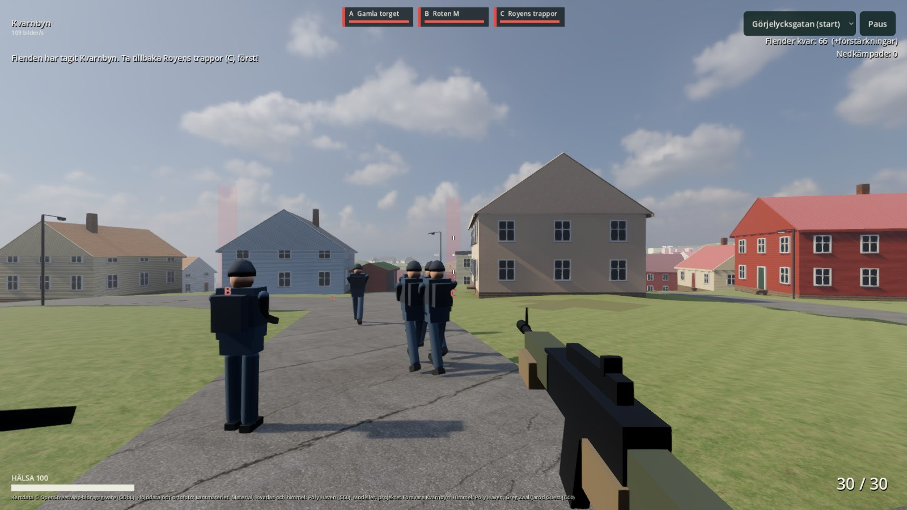
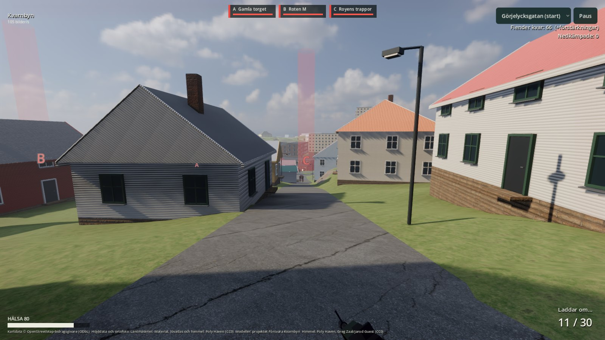

# Resultat — Fas B: spelbart (2026-10-29)

Byggt av Claude Code (Opus 5.5) i `godot/` ovanpå Fas A. Joels ram: **v1 är facit för
funktionerna (fiender, vapen, reload, hopp …), inte för känslan** — känslan är omgjord.

## Vad som finns

**Uppdraget (v1:s regler):** fienden har tagit Kvarnbyn och håller zonerna **A Gamla torget,
B Roten M och C Royens trappor**. Du startar vid Görjelycksgatan med 9 allierade. Ta tillbaka
C, B och A; en zon tas av den sida som ensam står i den. Fienden får 3 förstärkningsvågor så
länge den håller någon zon. **Förlust:** basen (C) faller igen. **Vinst:** alla zoner våra och
inga fiender kvar.

| Funktion | Hur | v1-värde |
|---|---|---|
| Vapen (Ak 5) | hitscan, 30 skott, ~600 skott/min | 30 skott, 0,11 s mellan skott |
| Skada | 40 kropp, 100 huvud (huvudträffzon på soldaterna) | 40 / 100 |
| Omladdning | R eller tomt magasin: 1,7 s (2,2 s från tomt, med mantelljud) | 1,7 s |
| Siktläge | höger musknapp: FOV 72→48, mindre spridning, långsammare mus | — (nytt) |
| Rörelse | gå 4,4, spring 6,9 (Shift), huka 2,3 (C), hopp (mellanslag) | gå/spring/huka/hopp |
| Hälsa | 100; regenererar efter 5 s, snabbt; död → åter vid basen efter 5 s | 100, 8 s, 2/s |
| Fiender | ~60 i ockupation + 6 infiltratörer + 3 × 14 förstärkningar; garnison/anfall | 102 + 6 + 3 × 18 |
| Fiendernas eld | siktlinje var 0,4–0,7 s inom 75 m, skjuter inom 70 m, v1:s träffsannolikhet | samma |
| Allierade | 9 (3 vaktar C, 6 anfaller), förstärkning var 45:e s | samma |
| Zoner | ljuspelare + bokstav, färg efter ägare; HUD-staplar | samma regler |

**Känsla (ny, mot moderna FPS):** acceleration och broms, huvudgung, FOV ökar när man springer,
landningsdipp; vapnet gungar och svajar efter musen, sparkar bakåt; rekyl som lyfter kameran
och till 65 % återhämtar sig; spridning som växer med rörelse, hopp och eldgivning (syns i
hårkorset); mynningsflamma med ljus, spårljus vartannat skott, damm/gnistor/blod vid nedslag;
träffmarkör (vit), huvudskott/dödande skott (röd) med egna ljud; skadevinjett med riktningsbåge;
fotsteg; 3D-ljud för andras skott (lågpassat på avstånd). Alla ljud syntetiseras i koden — inga
ljudfiler. Esc pausar hela världen.

## Bilder

| | |
|---|---|
|  Start: de allierade går mot C |  På väg mot Royens trappor, omladdning |

## Mätningar

| | Värde |
|---|---|
| Bildfrekvens i strid (M5, 1600×900, ~75 soldater, realtids-GI på) | 102–109 fps |
| Fysik | 60 Hz; soldater > 90 m från spelaren rör sig utan kollisionsfysik → 3 ms/steg (var 9 ms) |
| Kontrollertest | grönt (kantsten, vägg, ögonhöjd, paus, pekskärm) |
| Automatiskt spelprov (`--bot`) | se nedan |

## Automatiskt spelprov

`godot --headless --path v2/kvarnbyn/godot -- --bot --speed=4 --botlimit=1500` låter en bot spela:
den tar zonerna C → B → A längs vägnätet, siktar på närmaste synliga fiende med lite fel,
skjuter, laddar om, vänder hem när basen anfalls. Resultat:

| Omgång (25 min speltid, 4× fart) | Utfall |
|---|---|
| Första, v1:s erövringstakt | **förlust efter 2 min**: basen C föll medan boten var på väg mot B |
| Andra, nuvarande balans | **tidsgräns** efter 25 min: 72 nedkämpade (19 huvudträffar), 0 stupad; C och B våra, A kvar hos fienden (9 fiender i zonen, 10 kvar totalt), alla förstärkningar slut |

Omgången håller, kan inte förloras på ett par minuter och går att driva framåt. Boten
klarar inte slutstriden vid A (den anfaller rakt in i en tät grupp). Att den aldrig stupar
säger mer om boten än om svårigheten: den står ofta kvar bakom de allierade. Joels egen
spelomgång avgör om fienderna träffar för lite.

## Balansändringar mot v1 (och varför)

- **Fiendens erövringstakt halverad** (0,07 → 0,035/s): med v1:s takt tog 3 fiender basen på
  under 5 s och första botomgången förlorade efter 2 min utan chans att svara på larmet.
- **Regeneration** 5 s / 25 per s (v1: 8 s / 2 per s) — modern känsla, Joel bad om ny känsla.
- **Färre fiender** (60 + 6 + 3 × 14 i stället för 102 + 6 + 3 × 18) — prestanda och tempo.
Allt står i `godot/assets/game.json` (skrivs av `pipeline/site.py`) och kan justeras.

## Kända brister

- Soldaterna är klossfigurer (byggda av lådor/kapslar i koden) — riktiga CC0-soldatmodeller
  med animationer kräver nedladdning (~10–20 MB).
- Vapnet är byggt av lådor; ingen omladdningsanimation av händerna, bara vapnets rörelse.
- Ingen karta/minimap, inga granater, ett vapen. Fienderna söker inte skydd.
- Ljuden är syntetiska och enkla.
- Soldater långt bort går genom staket/murar (ingen kollision > 90 m).

## Spela

```sh
open "v2/kvarnbyn/desktop/app/Försvara Kvarnbyn.app"
```

WASD gå · Shift spring · C huka · Mellanslag hoppa · Vänster mus skjut · Höger mus sikta ·
R ladda om · Esc paus. Menyn: "Lägre belastning" stänger av realtids-GI om det hackar.
