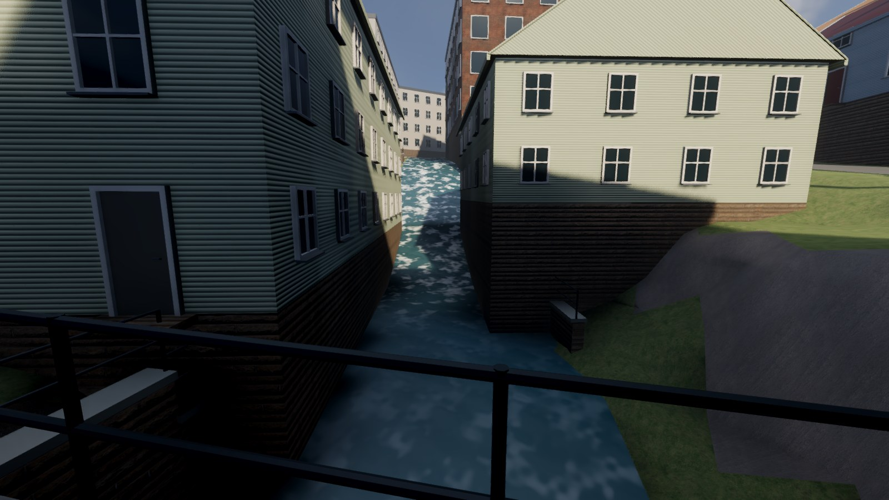
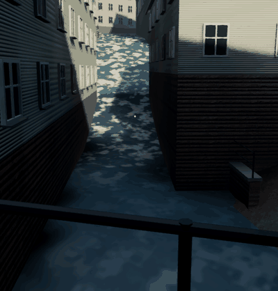

# Forsens rörelse och skum — 2026-11-02

Vattenmönstret följer nu åns befintliga nedströmsriktning. Brantare delar får
snabbare rörelse, tydligare krusning och vitt skum. Lugna partier förblir mörkare.
Det finns i den nya lokala Mac-appen.

Välj **Forsen – Forsebron**, **Forsen – gångbron** eller **Forsen – övre loppet**
i menyn. Eftermiddag och kväll använder samma vattenmaterial.

[Före, samma övre vy](evidence/fors_ovre_fore.jpg) ·
[Forsebron](evidence/fors_forsebron.jpg) ·
[Gångbron](evidence/fors_gangbron.jpg) ·
[Kväll](evidence/fors_kvall.jpg) · [Lägre bildkvalitet](evidence/fors_lag.jpg).

Före-bilderna är nativebilder från den tidigare shadern i editormotorn. Slutbilderna
kommer från exporterad Mac-app, med gränssnittet dolt. Ögonposition, siktpunkt och
synfält är samma. Bildernas FPS i loggarna är ögonblicksvärden, inget nytt riktmärke.

Slingan är 52 styrda faser av samma vattenmaterial i den riktiga nativevärlden,
beskuren och palettminskad för att bli liten. Den är ett rörelseprov, inte en
inspelning av en spelomgång. Ett litet skumparti rör sig 2 pixlar nedåt i bilden
över 0,333 s när kameran tittar uppströms; korrelation 0,957 mot 0,668 för stillastående.
Det stödjer rörelseriktningen i just den vyn, inte en uppmätt vattenhastighet.

## Vad som ändrats

Ett eget 512×512-datafält, 49 KB, byggs ur de tio befintliga åprofilerna. Riktningen
kommer från linjens ordning och skumstyrkan från höjdfallet över cirka 8 m. Helt plana
partier behåller linjens riktning. Skummängd och hastighet är konstnärliga proxyer;
ingen vattenföring, strömningssimulering eller exakt forsgeometri har mätts upp.

Alla 20 vattenytor delar ett material. Skummet ritas inom befintligt vatten och
är ogenomskinligt; inga extra partiklar, ljus, kolliderare eller vågförskjutna
vertexpunkter läggs till. Första nativeprovet gav långa linjer vid åkrökar eftersom
mönstret sträcktes med riktningen. Två korta förflyttningar med mjuk övergång
löste detta utan att röra vattenmeshen.

Världens råa och optimerade GLB samt kartbilden har exakt samma filhashar som
målvisningsleveransen. Alla gamla värden i site.json är identiska; endast
river_flow_profiles har tillkommit. Stad, AI-vägnät, spelregler och gamla vyer
är oförändrade. Tre nya kameravyer har lagts till.

## Kontroller och kvarstående arbete

- Åtta syntetiska profilprov samt alla 262 144 texlars encoding och PNG-retur passerar.
  En omkörning ger identiska bytes.
- 22 kontroller i riktig spelvärld passerar: importerade bildbytes/riktningar,
  lugnt/brant parti, alla faktiska vattenmaterial, ingen ny vattenkollision och
  menyer för ljus/bildkvalitet. Nativevarianten passerar 25 inklusive tre bilder.
- Full återbyggnad och Mac-export passerar på 124 s. Tidigare gång-, M29/M25/
  Stalleliden-, soldat-, vapen-, kart-, mål- och ljusprov passerar. Release-appen
  provar själv att både karta och flödesfält finns och används.
- Fem slutbilder från release-appen har granskats: tre forsvyer, kväll och
  lägre bildkvalitet. Alla agentkörningar är ljudlösa.

Åns planform och förenklade fall är fortfarande uppskattade. Intagsbassänger,
räckeslinjer och den lilla rundade tegelbyggnaden behöver ett eget samlat
platsprov. Den nya närreferensen och nivårisken finns i
[inventeringen](reference/nordbanken/INTAGSHUS-INVENTERING-2026-11-02.md).
Ingen ny hög uppfyllnad har byggts för att dölja nivåskillnaden där.
Forsdimma och mer detaljerade verkliga fall återstår.

[Material-/riktningstest](evidence/water-check.json) ·
[Nativeprov](evidence/water-native-check.json) ·
[Bevarad värld](evidence/water-preserved-check.json) ·
[Rörelseprov](evidence/water-motion-check.json) ·
[Leveransdata](evidence/delivery-fors-2026-11-02.json).
