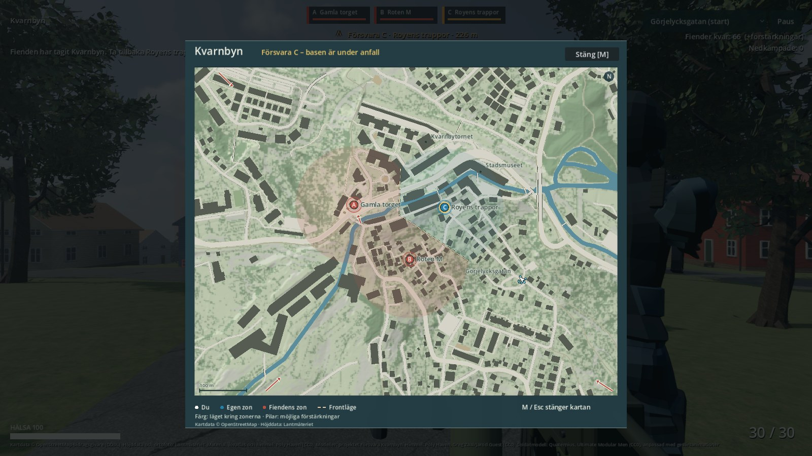

# Kartans frontläge — 2026-11-04

Båda kartorna visar nu röd/blå färg kring zonerna och en streckad front mellan
motsatta ägare. Fronten flyttas när en zon återtas. Stora kartan visar en gul
varning när den återtagna basen är under anfall.

Bilden använder kontrollerade zonägare och ett konstruerat baslarm för att visa
beteendet. Den är inte ett utfall från en spelomgång.

[Startläget](evidence/front-initial.jpg) · [Minikartan](evidence/front-mini.jpg) ·
[Alla zoner återtagna](evidence/front-reclaimed.jpg).

Färgen följer närmaste zon inom125m och lämnar resten neutralt. Den visar
schematiskt zonläge; faktiska fienders territorium eller rörelser mäts inte.
Fyra korta pilar visar möjliga förstärkningshåll från spelets konfigurerade
infallspunkter. De pekar mot närmaste fiendezon och är inga navigeringsvägar.
Pilarna försvinner när fienden saknar fler förstärkningar eller alla zoner är egna.

## Verifierat

- 30 kontroller passerar: riktig spelvärld/GameManager/karta, ägarbyten,
  basvillkor, uttömd/återställd förstärkning, alla zoner återtagna och klippning
  mot kartkant. Flyttad fiendesoldat ändrar inte kartan. Spelarrörelse räknar inte
  om frontgeometrin; den cachas till nästa zon-/budgetändring.
- 34 nativekontroller passerar inklusive fyra bilder. Provkameran för minikartan
  sätts på en riktig golvstråle. Första bildprovet använde en felaktig antagen
  markhöjd; det rättades i testfixturen, inte genom ändrad terräng.
- Full återbyggnad/Mac-export passerar på128s. Alla tidigare gång-, controller-,
  soldat-, vapen-, ljus-, fors-, kart-, mål- och markprov passerar.
- Ny separat frontgrind passerar i själva exporterade Mac-appen, även med bild.
  Tidigare releasegrindar för karta och vatten passerar.
- Rå/optimerad världs-GLB och kartbild har exakt samma SHA-256 som forsleveransen.
  Spelregler och AI-vägnät är byteidentiska med föregående commit.

App: `v2/kvarnbyn/desktop/app/Försvara Kvarnbyn.app`. Alla agentkörningar var
ljudlösa. Stora genererade filer finns endast lokalt. Inga nya nedladdade tillgångar.
[Leveransdata och hashar](evidence/delivery-front-2026-11-04.json).

Nästa: verkliga spelomgångar och kvarvarande AI-fel. Den separata [rättningen av basvakternas ersättare](RESULTAT-BASVAKTER.md)
är också genomförd efter kartleveransen. Tegelhuset/intagsanläggningen behöver fortfarande ett sammanhängande
platsunderlag. Nya faktiskt granskade gatubilder bekräftar material, men inte
bassängernas mått eller planform.
