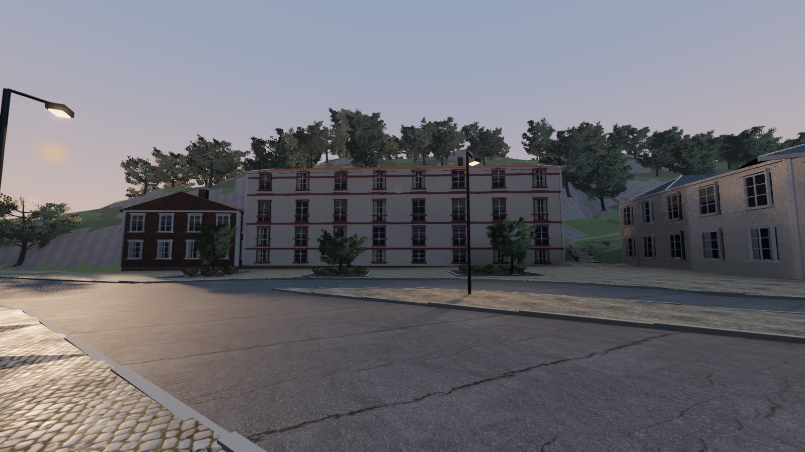
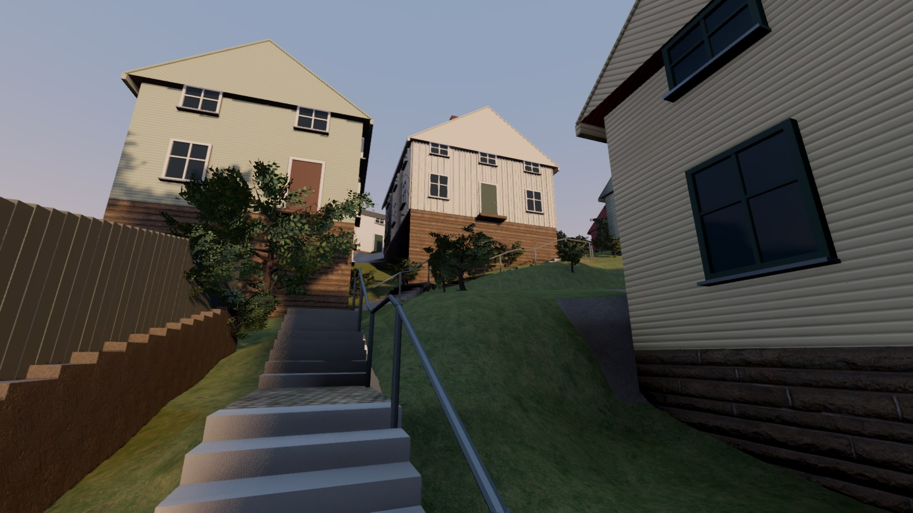

# Kvällsljus och gatlyktor — 2026-11-01

Start- och pausmenyn har nu ett ljusval: **Eftermiddag** eller **Kväll**. Det går
att byta på plats och fortsätta samma spel. Eftermiddag är fortfarande standard.
Kväll ger låg varm sol, svalare skuggor, en egen himmel och tända gatlyktor.

## Se och spela

Mac-appen finns lokalt i `desktop/app/Försvara Kvarnbyn.app`. Välj **Kväll** i menyn
och tryck Spela. Samtliga agentprov var ljudlösa; vanlig manuell spelstart har ljud.

Samma kameror och 72 graders synfält finns i
[torget, eftermiddag](evidence/kvall_torget_dag.jpg),
[Stalleliden, eftermiddag](evidence/kvall_stalleliden_dag.jpg) och
[M29, eftermiddag](evidence/kvall_m29_dag.jpg) / [M29, kväll](evidence/kvall_m29.jpg).
Även [menyn](evidence/kvall_meny.jpg), [lägre bildkvalitet](evidence/kvall_lag_belastning.jpg)
och [stridsprovet](evidence/kvall_strid.jpg) är granskade.

## Vad ljusprovet omfattar

De **216 befintliga lyktmodellerna** kan lysa i kvällsläget. Deras placeringar kommer
från den tidigare procedurmässiga utplaceringen längs vägarna, ungefär var 32:e meter;
de är inte inmätta verkliga lyktor. Ljuskällornas metadata är rättade från stolpens
mitt till armens synliga glas, med källan strax under glaset.

En fast grupp om högst **åtta närliggande spotljus med skuggor** följer spelaren.
Längre bort syns lyktglasens glöd utan full lokal belysning. Lägre belastning använder
högst fyra ljus, varav två har skuggor. Detta är en uttrycklig avvägning för datorn,
och ljusövergångarna vid längre promenader kan behöva finjusteras efter Joels spelprov.

Första mörka varianterna gömde trappsteg och soldater. Slutprofilen har därför ljusare
himmelsstrålning som fyller skuggorna. SDFGI behåller färgad indirekt belysning;
den enklare bildinställningen har en egen svag omgivningsbelysning. Det stämmer med
hur [Godots miljöljus och SDFGI](https://docs.godotengine.org/en/stable/classes/class_environment.html#class-environment-property-sdfgi-read-sky-light)
kopplas ihop; den faktiska läsbarheten bedömdes i spelets nativebilder.

Solvinkel, färgtemperatur och himmel är en **konstnärlig kvällsprofil**, inte en
astronomisk simulering av Mölndal vid ett visst datum. AI:s siktavstånd ändras inte av
ljusvalet. Hus, gånggeometri, vegetation och spelregler är samma som före ljuspasset.

## Kontroller och flyt

- 15 integrationskontroller passerar. Menyns riktiga signaler växlar ljuset och lyktglasens material, följer spelaren
  mellan områden och återställer eftermiddagens himmel/material. Upprepade byten
  samlar inte på sig fler solar eller lyktor. Paus och bildkvalitetsbyte fungerar.
- Hela återbyggnaden kör ljuskontrollen, kontroll-/gångprov, M29/Stallelidens kapselprov,
  180 globala gångpunkter, växtbaser samt soldat-/vapen-/trädprov före Mac-export.
  Hela kedjan med Mac-export passerade på 89 s; även `npm run build` passerar.
  GLB-filerna har exakt samma SHA-256 som Stalleliden-leveransen före ljuspasset.
- Två native stridsprov på **Apple M5 / Metal / Forward+**, 8 s uppvärmning följt av
  20 s mätning, 85 följda soldater och tio extra fiender nära spelaren vid torget:

| Läge | Median bilder/s | Nedre 5:e percentilen | Aktiva lyktljus |
|---|---:|---:|---:|
| Eftermiddag | 69 | 67 | 0 |
| Kväll | 65 | 59 | 8 med skuggor |

Proven använder samma kamera och spelarsituation med en odödlig stationär testspelare.
De passerar stridskontrollerna utan väggpassager. Det är korta stickprov på denna dator;
de bevisar inte jämnt flyt över hela kartan eller på andra datorer. GPU-timern rapporterar
0 och används inte som mätvärde. Stridsbilden är från detta särskilda belastningsprov.

[Ljus-/menykontroll](evidence/lighting-check.json) ·
[Native menybyteskontroll](evidence/lighting-native-check.json) ·
[Eftermiddagsmätning](evidence/lighting-combat-day.json) ·
[Kvällsmätning](evidence/lighting-combat-evening.json).

## Återbyggnad och nästa steg

`v2/kvarnbyn/rebuild.sh` bygger även ljusprovet och Mac-appen. Källorna är
`godot/scripts/lighting.gd`, `street_lights.gd`, `world.gd` och `overlay.gd`.
Inga nya modeller, material eller himmelsbilder behövde hämtas. Storfiler ligger lokalt.

Nästa platsarbete är **M24/M25:s husvolymer, grunder, tak och entréer** vid Stalleliden,
och bättre bildstöd för M31:s fasader. Joels bedömning av igenkänning och kvällsljus
återstår; nytt ljus löser inte de fortfarande generiska husproportionerna.
