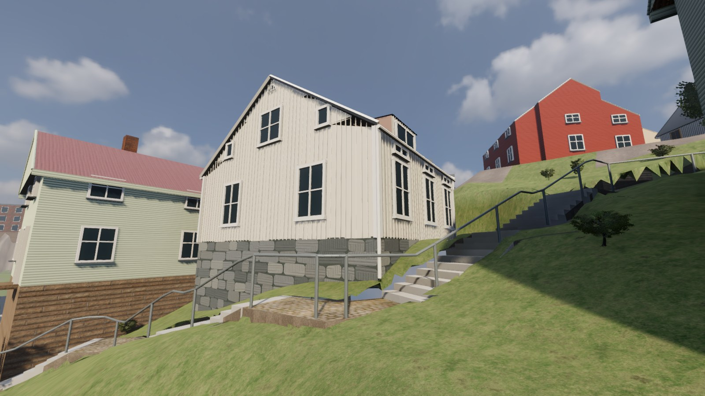
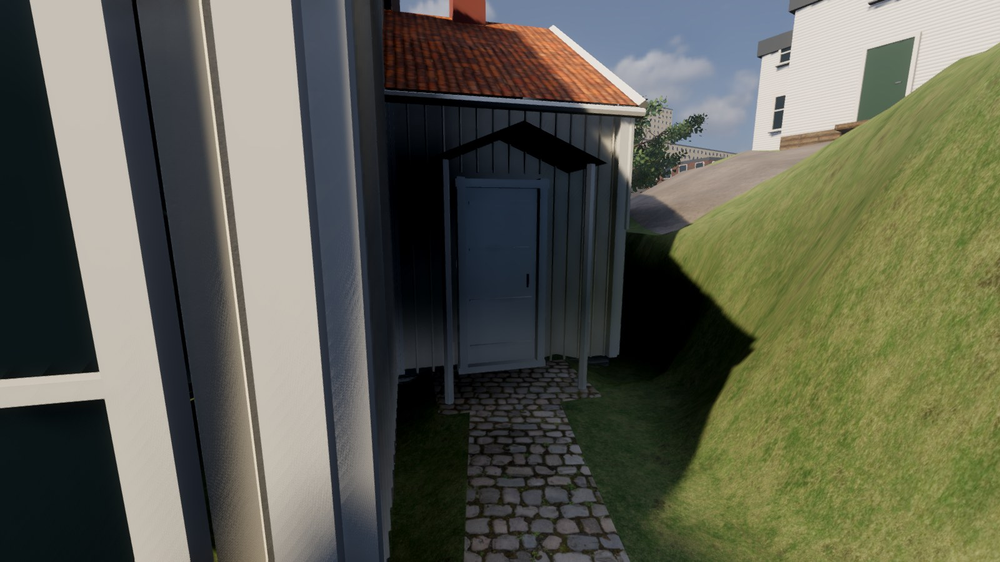

# Roten M 25 — hus och entré, 2026-11-02

M25 vid Stalleliden har nu en egen husmodell och en gångbar anslutning från det
befintliga vilplanet till dörren. Den gamla rektangulära tvåvåningsmodellen med
påhittad gavelentré är ersatt. Den allmänna trappan behåller sina profiler och ytor.

## Se och spela

Den nya lokala Mac-appen finns i `desktop/app/Försvara Kvarnbyn.app`.
Välj **Roten M 25 – gaveln**, **från gårdssidan** eller **entrén** i startmenyn.
Eftermiddag/Kväll fungerar som tidigare. Alla agenttester körs utan ljud;
vanlig spelstart har ljud.

[Samma hus i kvällsljus](evidence/m25_kvall.jpg).

[Före från samma gårdssida](evidence/m25_gardsvy_fore.jpg) ·
[Gaveln före](evidence/m25_gavel_fore.jpg) · [Gaveln efter](evidence/m25_gavel.jpg).
Jämförelsen använder samma x/z, målpunkt och synfält. Kamerans markberäkning och
avrundning skiljer mindre än en centimeter i de två gemensamma gavelvyerna.

## Vad som är byggt

- Originalets L-formade OSM-kontur, cirka 75 m², ersätter den större rektangeln.
- En full väggvåning med vind, gulvit stående panel och enkla vita foder. Västgavelns
  två stora fönster, centrala vindsfönster, små sidoljus och halvrunda ventil.
- Takkupa på sydsidan, grått plåttak på huvudvolymen och rött tegel på tillbyggnaden.
  Grå oregelbundna grundstenar följer lokal mark i stället för en enda hög brun låda.
- Dörr och litet öppet skärmtak i det indragna L-hörnet. Ingen interiör är byggd.
- Cirka 55 m² entrégång, dörrplan och begränsad uppförsskärning. Gången ansluter
  till ett gammalt vilplan, med 0,68 m hals och cirka 0,85 m gångbredd. Den kopplas
  även till soldaternas befintliga gångnät. Dörren är stängd och stoppar spelaren.
- Den öppna gavelmarken frigörs från slumpade växtproxyer; närliggande träd får
  större fasadavstånd och Stallelidens buskproxyer får lägre proportioner.

## Underlag och begränsningar

[Referensloggen](reference/stalleliden-hus/OBSERVATIONER.md) skiljer synliga drag
från uppskattningar. Fotografens P1020319 och P1020320 från 2017 är faktiskt
granskade; inga fotopixlar följer med spelet eller repot. All geometri är egen,
med redan befintliga material och träd. Inga nya nedladdningar behövdes.

**Alla exakta mått, golvhöjden raw 33,10 m, takdelning, dolda sidor och gångens
sträckning är uppskattningar.** En lokal markskärning behövs där DTM annars skär genom huset. Intill gången
ges marken en 0,55 m skuldra och 1,85 m mjuk återgång till den gamla terrängen;
bildprovet visade att den första smala skärningen blev för brant. Tekniska slutna markkanter är inte nya observerade stödmurar.
Stengrundens höjd behöver fortfarande bedömas visuellt mot platsen.

Fotots lilla separata steg-/rampmotiv vid västgaveln är inte byggt: riktning och
slutpunkter är inte tillräckligt säkra. M24 lämnas tills bättre fasadunderlag finns.
Den granskade Maps-vyn hamnade norr om huset och skyms av fabrik/träd. M31:s
dolda detaljer är också fortsatt obekräftade. Joels igenkänningsbedömning återstår.

## Kontroller och återbyggnad

- Riktig importerad Godot-kollision och spelarens kapsel: tre punktprov, båda
  gångriktningarna, faktiskt dörrstopp och fri gångpassage passerar. 92 golvprov per
  riktning utan fel; kapselns största höjdavvikelse är under 3 mm på entrégången.
- GLB: 141 prover längs hela gången och 20 cm på vardera sidan. Inga saknade
  synliga/kolliderande ytor eller höjdglapp. Husets faktiska väggkollision följer
  originalets L-gräns (kontrolltolerans 1 cm).
- Hela Stallelidens 112 m åt båda håll, räcke, M29:s gård/grind, världens 180
  gångpunkter, kontroller, vapen, soldater, träd och kvällsljus passerar.
- Trappans metadata är exakt oförändrade. Gamla asfalt-/vattenmeshar och broar
  behåller sina geometrisignaturer. Alla 47 Stalleliden-växtbaser möter verklig mark.
- `rebuild.sh` bygger hela världen, kör de nya M25-kontrollerna och exporterar appen.
  Full kedja passerar på 104 s; `npm run build` passerar. Slutbilderna är från den exporterade Mac-appen.

[Gångprov](evidence/m25-ground-check.json) · [GLB-prov](evidence/m25-mesh-check.json) ·
[Bevarad geometri](evidence/m25-preserved-check.json) ·
[Leveransdata](evidence/delivery-m25-2026-11-02.json).

Källorna är `reference/stalleliden-hus/m25.json`, `blender/stalleliden_houses.py`
och `pipeline/m25_ground.py`. Stora Blender-/GLB-/appfiler finns bara lokalt.
Det frysta analytiska agentunderlaget i referensmappen beskriver passets början;
de länkade slutproven ovan avser den levererade geometrin.
