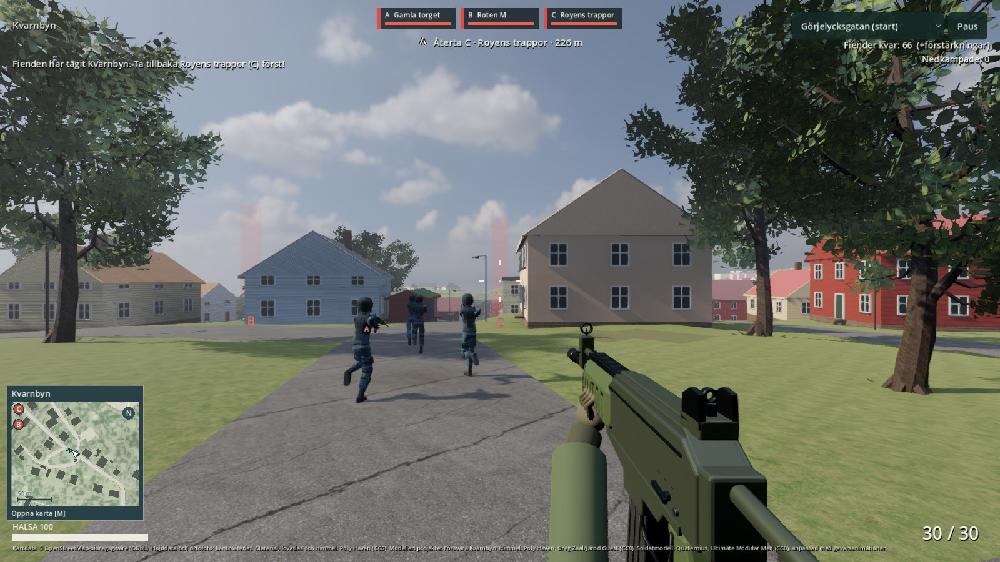
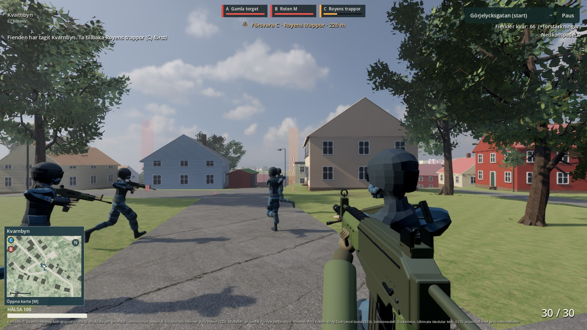

# Målvisning och basvarning — 2026-11-02

I stridsläget visar en pil och en kort textrad riktning och avstånd till nästa
område. En pågående attack mot den återtagna basen får företräde.
Det finns i den nya lokala Mac-appen.

Områdena föreslås i spelets befintliga ordning: **C Royens trappor → B Roten M →
A Gamla torget**. Avståndet mäts över kartan; pilen vrids med spelarens riktning.
Den visar målets riktning, inte en beräknad gångväg runt hus eller branter.

När den egna basen är omstridd och faktiskt har fiender i området visas
**Försvara C** i varmt gult. När alla områden är egna men fiender finns kvar står
**Rensa kvarvarande fiender**, utan att deras positioner avslöjas.
Måltexten döljs under promenadläge, när spelaren är död och efter avslutad omgång.

Basvarningsbilden är ett kontrollerat tillstånd i den riktiga spelvärlden: C är eget,
omstritt och har två registrerade fiender. Bilden är inte ett naturligt omgångsutfall.
Den vanliga målbilden ovan kommer från den exporterade appens normala stridsstart.

23 kontroller med verklig spelvärld och HUD passerar: målbyte, basvarningens villkor,
fyra väderstreck, spelarrotation, horisontellt avstånd och när visningen ska döljas.
Nativeprovet passerar även bildsparandet, totalt24 kontroller. Hela återbyggnaden
och Mac-exporten passerar på122s, inklusive tidigare mark-, soldat-, ljus- och kartprov.
Den exporterade appens kartkontroll passerar också. Alla agentprov är ljudlösa.

Världsmodellerna och kartbilden har exakt samma filhashar som åbanksleveransen.
Ingen AI eller svårighetsbalans ändras i detta pass. Det tidigare botutfallet var
en förlust; Joels egen runda behövs fortfarande för att bedöma tempot och hur lätt
det är att upptäcka och hinna tillbaka till ett basanfall.

[Målprov](evidence/objective-check.json) ·
[Nativeprov](evidence/objective-native-check.json) ·
[Leveransdata](evidence/delivery-objective-2026-11-02.json) ·
[Tidigare botomgång](evidence/round-2026-11-02.json).
