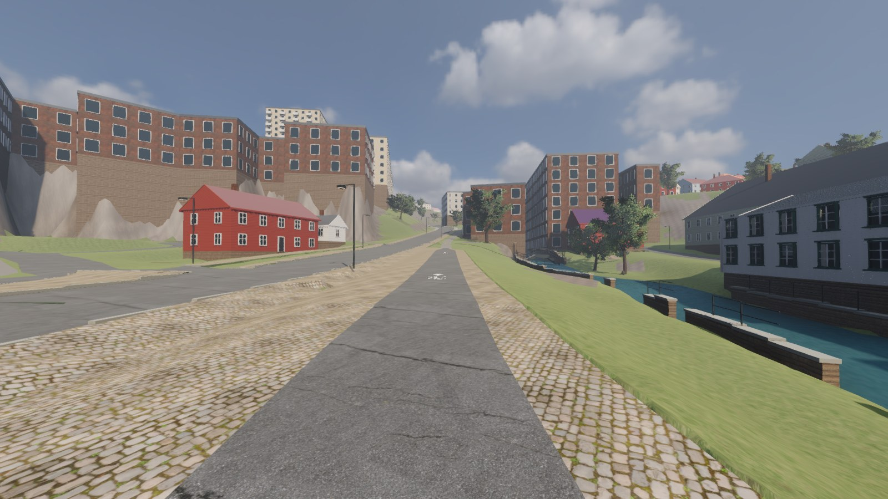
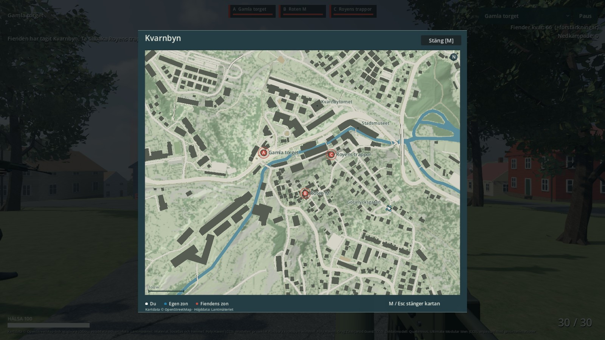

# Norra åbanken och spelkartan — 2026-11-02

Gång-/cykelstråket mellan Kvarnbygatan och ån har fått asfalt, gångsten och en
sammanhängande förplats. Spelet har också fått en minikarta och en stor karta.
Båda delarna finns i den lokala Mac-appen.

## Se och spela

Välj **Norra åbanken – från torget, från gatan eller gångstråket** i menyn för
att granska platsen. **M** öppnar stora kartan och pausar spelet; **M, Esc eller
Stäng** återgår. Minikartan visar närmiljön med norr uppåt. Din pil visar riktningen,
zonerna färgas efter ägare och allierade syns som blå markörer. Osedda fiender avslöjas
inte. Alla agenttester körs tyst; normal spelstart har ljud.

[Före, samma gångvy](evidence/north_bank_walk_fore.jpg) ·
[Från gatan före](evidence/north_bank_road_fore.jpg) ·
[Från gatan efter](evidence/north_bank_road.jpg) · [Minikartan](evidence/map_mini.jpg).

## Platsprovet

Två faktiskt granskade Street View-vyer från maj 2026 visar en byggd miljö med
asfaltbana, cykelmålningar och grå stenremsor. OSM w34930250 säger redan asfalt;
den gamla generella tolkningen ritade alla `path` som stig.

Det avgränsade stråket är cirka 80,4 m och markbearbetningen550 m². Uppskattade
bredder:2,8 m asfalt,1,2 m gångsten och0,9 m stenavskiljare. Den anslutande förplatsen
möter befintlig trottoar. Tre egna cykel-/pilmarkeringar följer den verkliga nya
asfaltsmeshen. Höjderna förankras i gatans gamla färdiga golv; ändarna får mjuka
övergångar till den gamla vägen. Nav-grafen följer den nya profilen.

Den större gamla1 658 m²-polygonen är fortsatt en grov skiss. Vattenintagets bassänger,
exakta räckeslinjer, den lilla tegelbyggnaden och möbler/planteringar återstår.
Den gamla kanalmodellen ändras inte. Ingen ny påhittad räckeslinje byggs mitt på
förplatsen. **Alla exakta mått, konturer och höjder är uppskattade.**

[Referenslogg](reference/nordbanken/OBSERVATIONER.md) och
[kartstudie över befintligt ortofoto/OSM](reference/nordbanken/ortho_alignment.jpg).
Ortofoto i kartstudien: Lantmäteriet 2024, CC BY 4.0; OSM-bidragsgivare, ODbL.
Inga Street View-foton lagras i repo eller används som spelmaterial.

## Kartan

Den egna kartbilden byggs ur aktuella huskonturer, gångytor, vatten och höjddata.
Den omfattar hela den 900×700 m spelbara kärnan och visar381 hus och16 broar.
Den statiska bilden är2 400×1 867 pixlar, cirka 2,72 MB före packning. Rörelse- och
zonmarkörer ritas ovanpå. Den genererade bilden och de stora världsfilerna är lokala;
`rebuild.sh` återskapar dem.

## Kontroller

- Riktig importerad kollision/spelarkapsel: sex punkter, fyra hela80 m-banor
  (asfalt och gångsten åt båda håll) och fyra öppna tvär-/längspassager passerar.
  644 golvprov per riktning; största kapselprofilavvikelse3,3 cm.
- GLB:3 876 prover längs stråken och20 cm på vardera sidan, utan saknade ytor/glapp.
  327 trottoarfogar har högst5,84 mm höjdskillnad;510 interna fogar högst14,57 mm.
  Ändfogen rättades i geometrin efter ett missat faktiskt fysikprov.
- Gammal asfalt 109 708 trianglar, vatten 10 175, broar 6 720 och huvudtrappa 10 887
  har identiska geometrisignaturer med M25-baslinjen. Gamla Torget/M29/M25/
  Stalleliden-metadata och alla tidigare meshslag utom den ersatta stigen bevaras.
- Kartkomponent:27 kontroller gröna. Riktig spelvärld/inmatning:19 kontroller gröna,
  inklusive M/Esc, paus av strid/rörelse, vanlig pausmeny, upprepade öppningar,
  zonägarbyte och slutskärm. Exporterad app provar själv att kartan verkligen finns
  och går att öppna. Nativebilder visar båda kartlägena.
- Hela återbyggnaden inklusive tidigare kontroller, M29/M25/Stalleliden,180 globala
  gångpunkter, soldater, vapen, träd och kvällsljus passerar. `npm run build` passerar.
  Slutlig full kedja inklusive releasegrinden passerar på 115 s. Bildernas FPS är ögonblicksvärden, inget nytt prestandariktmärke.

[Gångprov](evidence/north-bank-ground-check.json) ·
[Meshprov](evidence/north-bank-mesh-check.json) ·
[Bevarad geometri](evidence/north-bank-preserved-check.json) ·
[Fogprov](evidence/north-bank-seam-check.json) ·
[Kartprov](evidence/map-check.json) · [Spel-/kartprov](evidence/map-world-check.json) ·
[Leveransdata](evidence/delivery-north-bank-map-2026-11-02.json).

Nästa byggarbete är bättre husreferenser för M24/M31 och fortsatt platsvis miljö.
Åns intagsanläggning behöver eget underlag innan resten av bankens miljö byggs.
