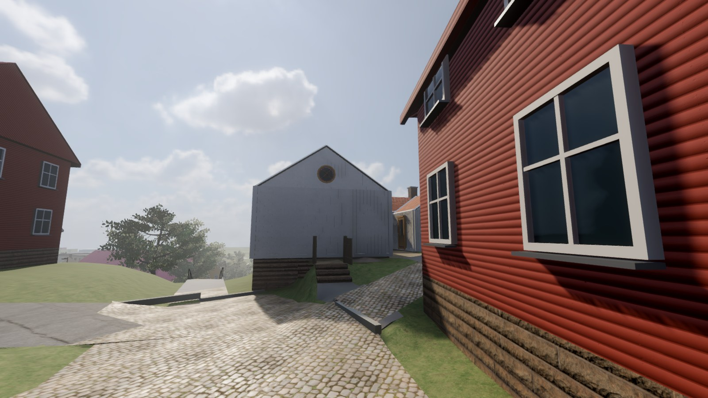
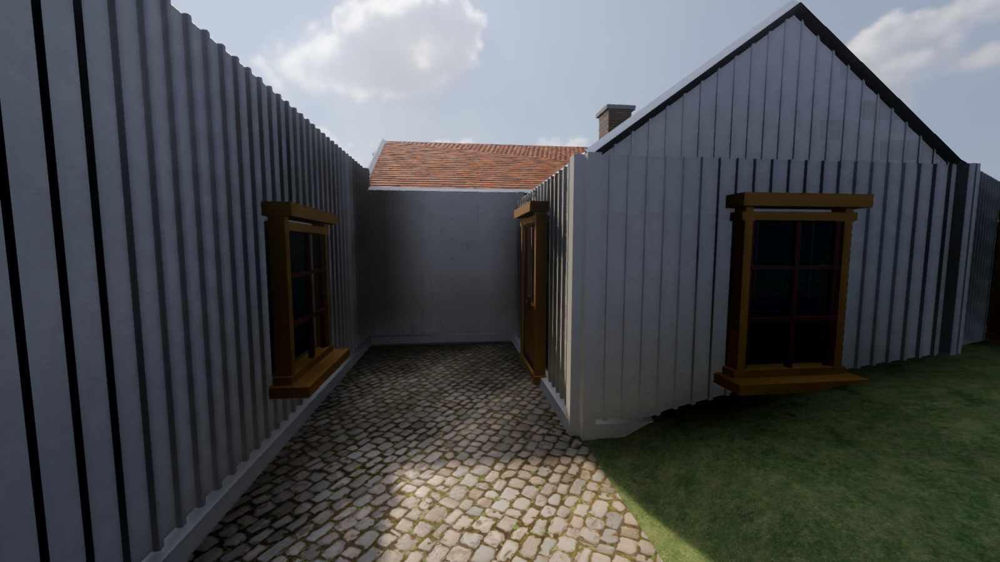
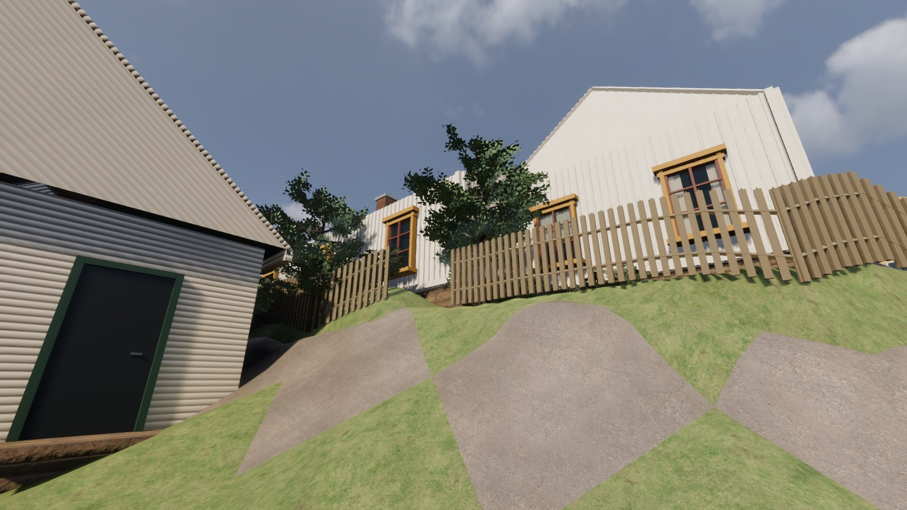

# Roten M 29 — platsprov 2026-10-31

M29 har nu en egen låg vit husgrupp med sadeltaksdelar, stående panel, ockrafoder,
rödbruna fönster och den runda vindrutan mot Royens gata. Den tidigare automatiska
modellen hade två fulla våningar och ett högt valmat tak. OSM-fotavtrycket behålls.

Gården har separata ytor av sten, grus, gräs och berg, tre entrésteg, låg stenbäddkant,
öppen trägrind och trädgårdsstaket. Två mindre lövträd och 17 buskgrupper kompletterar
skogen och torgets tidigare planteringar. Provet omfattar cirka **83,5 m²** vid M29.
Smågatsten ersätter asfaltutseendet på de granskade stråken inom provrutan, utan att
ändra deras höjder eller gångtrianglar.

## Se och spela

Mac-appen ligger lokalt i `desktop/app/Försvara Kvarnbyn.app`. Välj
**Roten M 29 – gaveln**, **gården** eller **trädgården** bland startvyerna för en närbild.
Vanlig spelstart har ljud; samtliga automatiska prov använder Dummy-ljud och mutad master.

## Vad som är belagt och vad som återstår

[Referensloggen](reference/roten-m/OBSERVATIONER.md) innehåller länkar till den faktiskt
granskade Street View-bilden från augusti 2024 och publika exteriörer för M29.
Inga tredjepartsfoton följer med spelet eller repot. Husets utseende, berg i dagen,
gårdskaraktären och de låga kanterna stöds av bilderna. Exakta höjder, takdelning,
konturer, växtarter och dolda fasader är **uppskattningar**.

M30/M31 och grannhusen är fortfarande automatiskt tolkad kontext. Det finns inte
bildstöd för att bygga en hög M31-mur enbart ur DTM:s nivåskillnad. Nästa platsrunda
bör granska de husen och anslutningen till Stalliden; kvarteret är inte färdigåterskapat.
Kvällsljuset återstår också. Joels bedömning av igenkänningen är inte inhämtad.

## Återbyggnad

Kör `v2/kvarnbyn/rebuild.sh` från repots rot. Den bygger även gårdsprovet, kör dess
verkliga spelarkapsel genom entré och grind och avbryter om något kontrollsteg fallerar.
Huskällan ligger i `reference/roten-m/house.json`, markbeskrivningen i
`pipeline/roten_ground.py`, Blender-hjälpen i `blender/roten.py`.

De stora GLB-/Blender-/appfilerna ligger bara lokalt. Ingen ny tillgång behövde laddas ner.

## Kontroller och praktiska begränsningar

- **927 actual-mesh-prover** med 30 cm mellanrum: inga hål, inga saknade nya golv och
  ingen oavsiktlig skillnad mellan synlig mark och gångyta. Trappans ramp ligger högst
  17,5 cm från stegytan, inom ett trappsteg. Asfalt-, vatten- och brotrianglar är oförändrade.
- **Godot:** 11 höjd-/golvprov, två kompletta kapselpromenader, öppen grind och stopp mot
  staket passerar. Största punktavvikelsen är 5,6 cm på det uppskattade berget.
- Hela världens **180/180** gångpunkter, kontroller/raket/flyg, trädimport, soldater och
  vapnets 13 kontroller passerar. 3 232 växtmeshinstanser återställs efter importen.
- Full återbyggnad, Mac-export och `npm run build` passerar. Nativebilderna är från den
  exporterade appen. Prov med bildtagning och fysik kördes utan ljud.

Kontrollen hittade en verklig höjdknäck när närmaste väg växlade, undersamplade bergformer
i 2 m-nätet och en spetsig terrängkant i slutbilden. De rättades med en jämn anslutning,
0,4 m-trianglar för M29 samt en 0,8 m övergång i anslutande terräng. Slutna kantfyllningar
är teknisk tolkning av markvolymen, inte fler uppmätta stödmurar. Gräs-/bergkanter och
växtmodeller är fortfarande ett tidigt platsprov, och dolda fasader behöver bättre underlag.

[Maskinläsbart gångprov](evidence/roten-ground-check.json) ·
[Blender-prov](evidence/roten-mesh-after.json) ·
[Dataprov](reference/roten-m/qa-roten-ground-agent.json).
