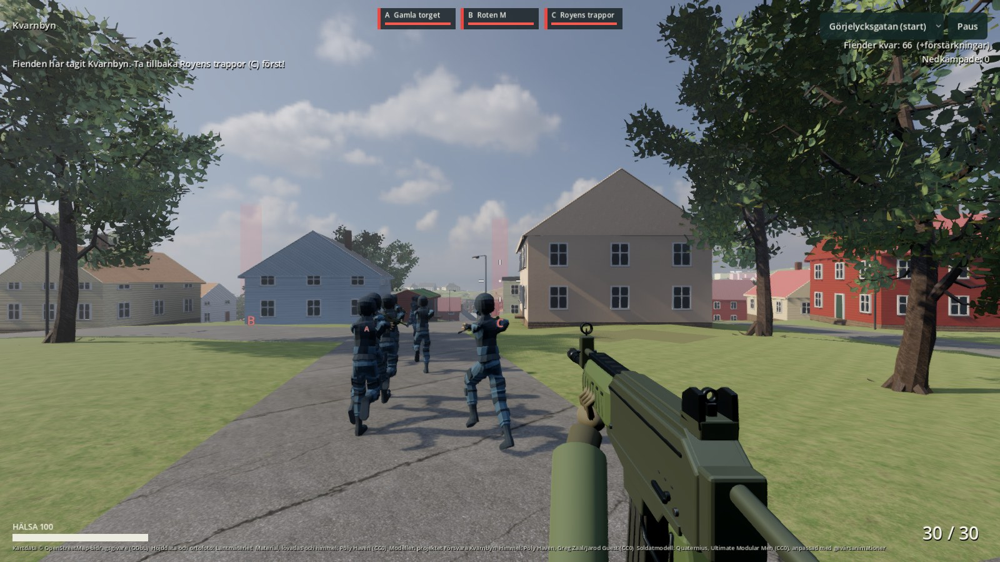
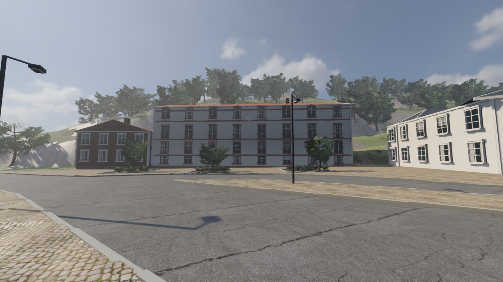

# Resultat — soldater, Ak 5 och torgförgården, 2026-10-30

Ny Mac-app finns i **`desktop/app/Försvara Kvarnbyn.app`**, även packad som
`desktop/Kvarnbyn.zip` (cirka 238 MB, bara lokalt). Den exporterade appen har startats utan
editorn med både strid och torgvy. Källor, återbyggnad och små bevisfiler versionshanteras.

## Soldater och strid

Klossfigurerna är ersatta med en riggad Quaternius CC0-modell: 62 ben och 24 klipp.
Gång, löpning, sid-/bakåtrörelse och död väljs efter faktisk rörelse. Gevärsfattningen
bakas i Blender, huvudträffzonen följer huvudbenet och de två sidorna har skilda färger.
Det är fortfarande en **stiliserad standardsoldat**, ingen fotorealistisk svensk uniform.

Fiender byter till prövade flankpositioner, söker skydd efter träffar och minns den senast
sedda positionen en kort stund. Varje skott kräver aktuell sikt från både huvud och mynning;
en soldat kan alltså inte skjuta genom lågt skydd bara för att huvudet ser över det.
Fiendernas eldintervall är 8 % kortare och träffchansen 8 % högre; värdena ligger i
`pipeline/site.py` → `godot/assets/game.json`. Joels spelprov avgör svårigheten.

Spelarens Ak 5 är byggd i Blender efter den äldre gröna modellen, med fasade former,
handskydd, kolv, öppna järnsikten och separata rörliga magasin/manteldelar. Sikten och
mynningen är kalibrerade mot kameran. Händerna har fortfarande en förenklad omladdningspose.
Se [modellunderlaget](blender/AK5.md) och [soldatens källa/licens](assets-src/soldier/README.md).

## Förgården och den saknade grönskan

Det befintliga platsunderlaget hade tappats i Fas A. Förgården framför Musikskolan/Corpus
har nu cirka **940 m² sten och 82 m² planteringar**, tre unga träd och 24 låga buskproxyer.
Stenläggning och tre träd är visuellt observerade i det tidigare Street View-passet;
konturer, höjder, trädmått och buskarnas utformning är uppskattade. Den grövre nordbanksytan
är uppskjuten till ett eget platsprov.

Marken klipps vid ytorna, får fyllda ytterkanter och graderas mot befintliga anslutningar.
Asfalt, vatten och brodäck är oförändrade. På samma 3 757 provpunkter sjönk antalet
höjdändringar över 22 cm per halvmeter från **93 till 0**; största kvarvarande ändring är
18,31 cm. Inga hål eller skillnader mellan ritad mark och kollision upptäcktes.
[Före](evidence/torg-ground-before-2026-10-30.jpg) och
[efter](evidence/torg-ground-after-2026-10-30.jpg) är matchade Blenderbilder med 1,70 m ögonhöjd.

Appkontrollen avslöjade dessutom att skogens instansplaceringar försvann vid headless-import.
Importören sparar nu även CPU-transformer och runtime återställer dem. Att kontrollera den
faktiska appbilden var avgörande: den tidigare Blenderbilden visade träd medan spelbilden var
kal. Godot dokumenterar att renderingstjänsten ger dummyvärden i headless-läge
([RenderingServer](https://docs.godotengine.org/en/stable/classes/class_renderingserver.html)).
Ett nytt prov kontrollerar **478 grupper och 3 194 meshinstanser**; skog, gatuträd och buskar
är därefter visuellt kontrollerade även i den exporterade appen.

## Verifiering

| Prov | Resultat |
|---|---|
| Spelarkontroller | Kantsten, vägg, paus, ögonhöjd, raket och flygläge gröna |
| Gångprov över hela världen | 180 av 180 landar på rätt yta |
| Soldatmodell | Sex animationslägen, huvudhöjd, mynning och dödsloop kontrollerade |
| Stridsarena | 6 av 6 flyttar över 3 m; skydd efter träff; 0 väggpenetrationer på 6 135 sampel |
| Skott mot nytt högt/lågt skydd | Ingen skada genom skyddet |
| Vapen | 13 kontroller gröna; stillastående siktfel 0 px; reload 1,7167/2,2167 s vid 60 Hz |
| Ny torgmark | 3 757 punkter, 0 hål, 0 saknad sten, 0 höjdspikar över gränsen |
| Exporterad Mac-app | Start, strid, nya modellresurser och synliga träd verifierade |
| Äldre webbbygget | `npm run build` grönt |

**Slutlig prestandamätning med synlig vegetation:** Godot 4.7.2, Forward+/Metal, M5,
1600 × 900-fönster, 10 s uppvärmning följt av 30 s mätning. Stillastående odödlig testspelare
på vägen vid C, tio extra fiender, 85 följda soldater. Median **72 bilder/s**, femte percentilen
**70 bilder/s**; fysik median 4,48 ms / p95 5,20 ms. AI-beslut tog cirka 0,40 ms per fysiksteg.
143 flankval och 371 skott registrerades; soldaterna rörde sig under 84,6 % av stridstiden.
Inga väggkorsningar på 2 344 närkontroller. GPU-timern gav inga användbara värden.

Detta är ett kort belastningsprov, inte alla lägen i en hel omgång. Tidigare 95/114-FPS-prov
saknade synliga träd och är märkta ersatta; de beskriver inte slutleveransens belastning.
Mätdata finns i [slutprovet](evidence/soldiers-warm-trees-2026-10-30.json).

Alla agentprov körs nu **ljudlöst**, även efter nästa återbyggnad. Vanlig spelstart har ljud.

## Nästa platsprov

Tomterna **Roten M 29–31**: verifiera murkrön, murfötter, gårdsnivåer och växtlighet visuellt,
bygg därefter ett litet sammanhängande prov med plana terrasser och riktiga stödmurar.
[Miljögranskningen](evidence/world-review-2026-10-30.md) beskriver varför detta är nästa
igenkänningshinder. Exakta tomtgränser/höjder är ännu inte verifierade. Kvällsljus ligger kvar
som nästa stämningspass efter modellerna; den större världen behöver fortfarande fler husrundor.
