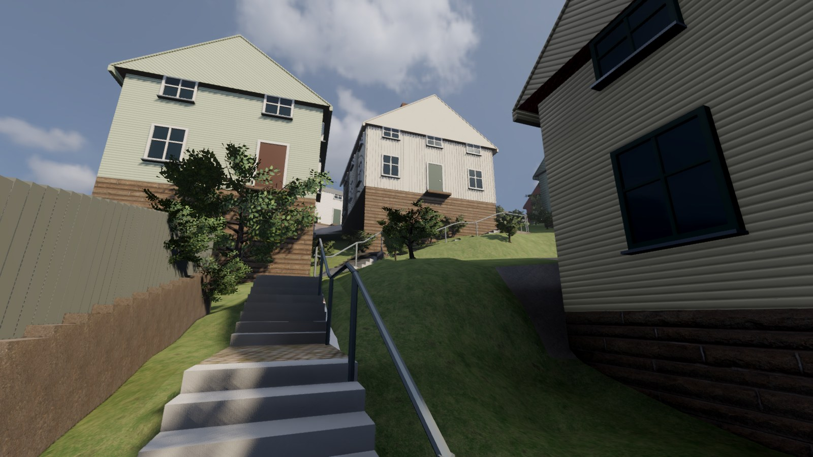
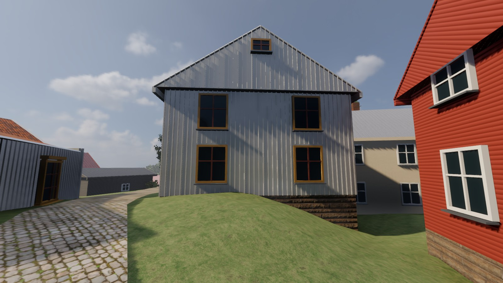

# Stalleliden och Roten M 30/31 — platsprov 2026-11-01

Hela promenaden från Roten M ned genom Stalleliden till Norra Forsåkersgatan hänger
nu ihop. De gamla separata trappmodellerna ersätts av korta lopp med vilplan,
sammanhängande gångprofil och ett enkelt metallräcke som också stoppar spelaren.
Det är ett färdigt gångprov och en första visuell bearbetning, inte en färdig
återskapelse av alla hus och tomter längs stråket.

## Se och spela

Den uppdaterade Mac-appen finns i `desktop/app/Försvara Kvarnbyn.app`. Startmenyn
har nya vyer för **Roten M 30** och **Stalleliden – övre delen, mittpartiet, nedre delen**.
Välj en vy och tryck Spela. Agenternas samtliga prov är ljudlösa; vanlig spelstart har ljud.

Före/efter från samma x/z, riktning och synfält finns för [mittpartiet före](evidence/stalleliden_mitt_fore.jpg)
och [M30 före](evidence/stalleliden_m30_fore.jpg). Kameran följer färdig markhöjd;
vid mittpartiet skiljer ögonhöjden 1,4 cm mellan versionerna.
Även [övre delen](evidence/stalleliden_ovre.jpg) och [nedre anslutningen](evidence/stalleliden_nedre.jpg)
är kontrollerade i den exporterade appen.

## Förändringar och underlag

- **M30:** vit stående panel, ockrafoder, rödbruna spröjsar och den lilla höga
  rektangulära vindrutan utifrån faktiskt granskad Street View. Två fönsterrader
  syns i en äldre vy; befintliga antagna vägg-/takhöjder behålls.
- **M31:** den ursprungliga OSM-konturen används i stället för en omslutande rektangel.
  Modellen upptar cirka 10,5 m² mindre mark. Det antagna sadeltaket klipps till konturen.
  Fasader, färg och höjder är fortfarande obekräftade; ingen ny hög M31-mur byggs.
- **M25:** blekt gulvit stående panel och vita detaljer efter referensbilden från 2017.
  Husets komplicerade volymer och fönsterindelning återstår att återskapa ordentligt.
- **Stalleliden:** cirka 147 m² gång-/trappyta, 16 korta trapplopp, vilplan och
  slutna markkanter. Fem mindre lövträd och 42 buskgrupper kompletterar grönskan.
  Cirka 379 m² gräsmark får egna finare trianglar. En kort stenmur med grått stående
  plank återger det observerade motivet på den norra höga tomten.

[Referensloggen](reference/stalliden/OBSERVATIONER.md) skiljer observationer från antaganden.
Alla exakta höjder, bredder, antal steg, vilplanslägen, murmått och växtpositioner är
**uppskattningar**. Den korta länken från trappfoten till gatan är ett uppskattat
topologiskt byggbeslut; de gamla väg- och stigytorna där bevaras. Tekniska kantfyllningar
är inte fler visuellt belagda stödmurar. Inga tredjepartsfoton används som spelmaterial.

## Kontroller

- **Verklig Godot-fysik:** 13 punktprov, två hela kapselpromenader om drygt 112 m,
  räckesstopp och fri gångpassage passerar. Ingen omplacering mellan delarna av en
  promenad. 1 390 golvprov per riktning utan fel; största höjdavvikelse cirka 4,8 cm.
  Kapselns största avvikelse från profilen är cirka 8,6 cm.
- **Exporterade GLB-trianglar:** 2 088 prover längs mitten och 20 cm på vardera sidan,
  utan saknad bild-/gångyta eller oavsiktligt glapp. Största skillnaden mellan synligt
  trappsteg och osynlig gångramp är 16,2 cm, inom ett steg.
  Alla 47 nya växtplaceringar vilar på exporterad mark, högst 1,5 cm från profilen.
  Sista provet hittade en svävande buske bakom planket; den upphöjda marken fick
  därför en egen trianguleringsgräns och slutna kanter före slutexporten.
- Gamla asfalt-/vattenmeshar och brobeskrivningar är identiska med den sparade
  baslinjen. Hela världens 180 gångpunkter, M29:s gård/grind, kontroller, soldater,
  vapen och trädimport passerar. 3 326 växtmeshinstanser återställs i runtime.
- Full återbyggnad och Mac-export passerar på 96 s; `npm run build` passerar.
  Slutbilderna är från Mac-appen, inte Blender-renderingar. Bildtagningens FPS-värden
  är ögonblicksbilder och används inte som ett nytt prestandariktmärke.

[Gång-/räckesprov](evidence/stalliden-ground-check.json) ·
[Slutlig GLB-kontroll](evidence/stalliden-mesh-after.json) ·
[Första staged-kontrollen mot baslinjen](evidence/stalliden-mesh-staged.json) ·
[Analytisk profilkontroll](reference/stalliden/qa-stalliden.json) ·
[Planteringskontroll](reference/stalliden/qa-garden.json).

## Återbyggnad och nästa steg

`v2/kvarnbyn/rebuild.sh` bygger platsprovet och kör båda områdenas verkliga kapselprov
före Mac-export. Källorna är `reference/stalliden/houses.json`, `pipeline/stalliden.py`,
`pipeline/stalliden_garden.py`, `blender/cottage_details.py` och `blender/stairkit.py`.
Stora GLB-/Blender-/appfiler ligger bara lokalt. Inga nya modeller eller material laddades ned.

Nästa separata prov är kvällsljus och gatlyktor från samma kameror. För fortsatt
platsigenkänning behövs bättre underlag för M31 samt egna volymer för M24/M25:
de stora generiska grunderna, dörrarna och takformerna dominerar fortfarande trappvyn.
Joels bedömning av igenkänningen återstår.
