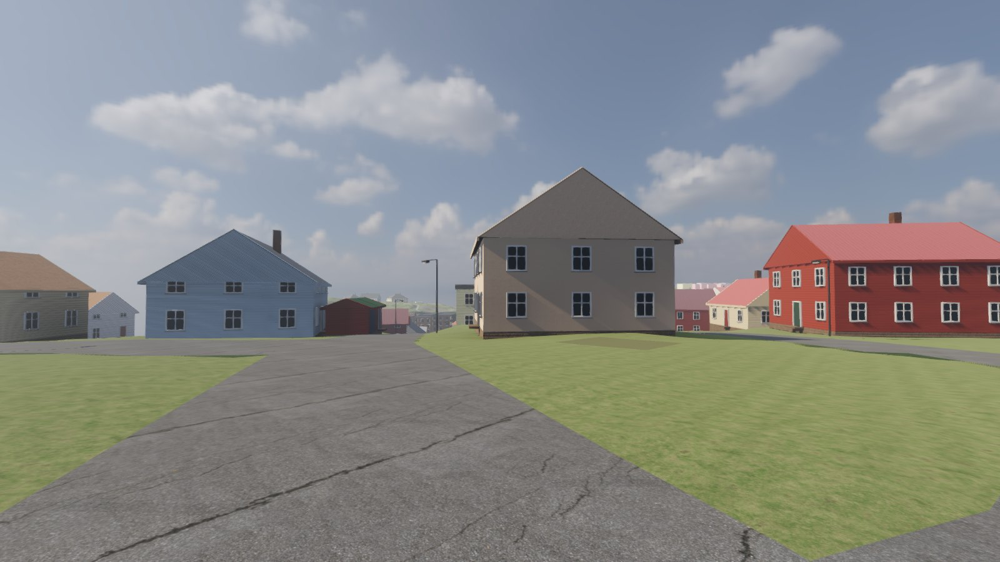
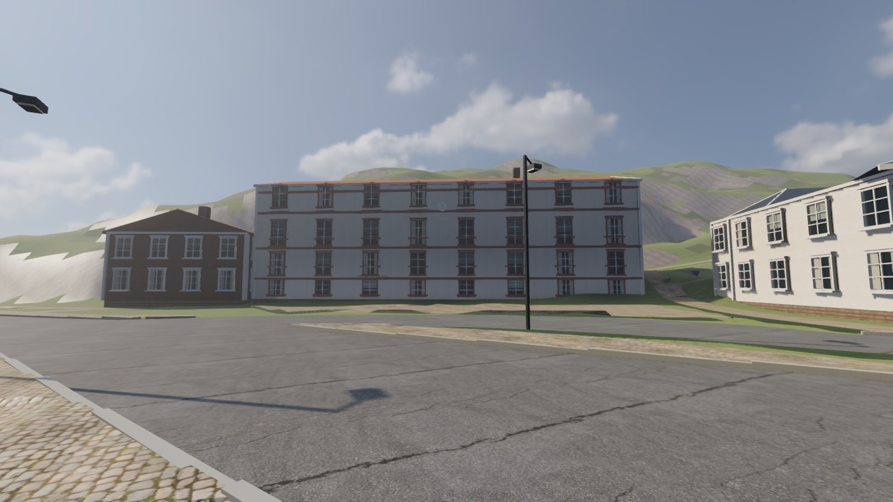
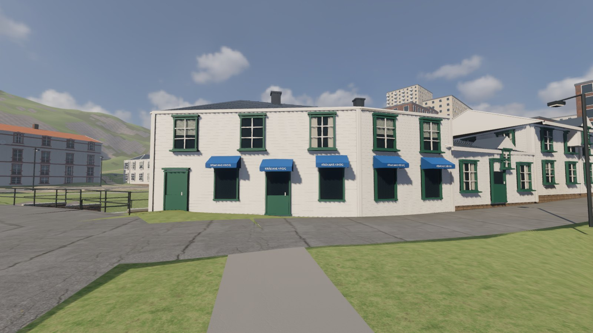
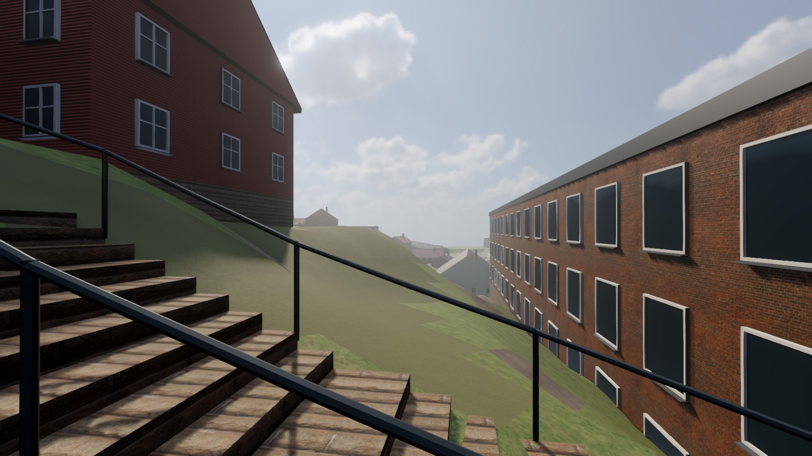
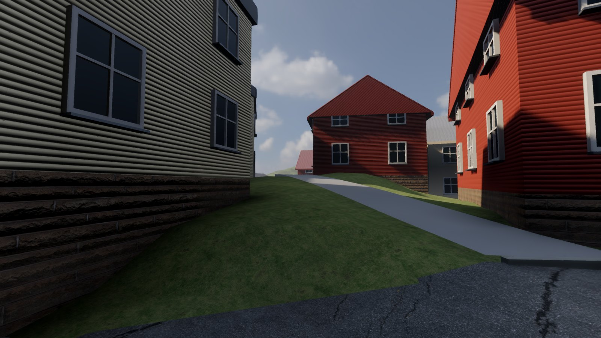
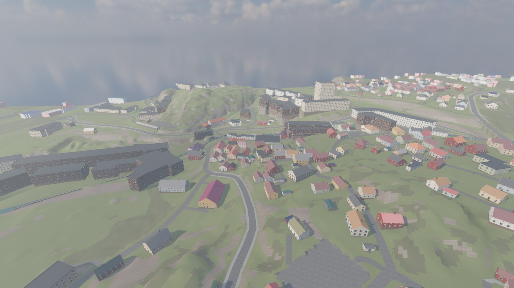

# Resultat — Fas A: Kvarnbyn som spelbar värld (2026-10-29)

Byggt av Claude Code (Opus 5.5) ovanpå Codex PoC Gamla torget. Brief: `BRIEF.md`.

## Svar

**Mätbart: klart.** Hela Kvarnbyns kärna, 900 × 700 m, går att gå runt i som en Mac-app med mus
och tangentbord: 381 hus i zonen, 1 734 kulisshus runt om, gator, trottoarer, ån med murar, 16
broar, 23 trappor (bland dem Royens trappor), 1 570 träd, 216 gatlyktor — i 111–120 bilder/s med
realtids-GI på M5. **Visuellt: Joels bedömning återstår.**

## Bilder (Godot, datorversion, ögonhöjd)

| | |
|---|---|
|  Start vid Görjelycksgatan (v1:s spawn) |  Gamla torget mot Musikskolan |
|  Kråkans krog (handgranskat hjältehus) |  Royens trappor (v1:s zon C) |
|  Roten M (v1:s zon B) |  Överblick |

Kontrollkarta ovanpå ortofotot (gator, ytor, ån, hus per hustyp, broar, lyktor, v1:s zoner):
`evidence/kontrollkarta.jpg`.

## Mätningar

| | Värde |
|---|---|
| Zon | 900 × 700 m (v1 x −250…650, z −400…300); kuliss ut till ~2,5 × 1,7 km |
| Hus i zonen | 381: 268 trähus, 63 bodar/garage, 30 flerbostadshus, 11 industri, 3 offentliga, 6 handgranskade hjältehus |
| Övrigt | 293 gatuprofiler, 16 broar, 23 trappor, 608 åmurssegment, 6 300 kantstensbitar, 216 gatlyktor, 1 570 träd |
| Hela kedjan (`rebuild.sh --no-export`) | 57 s: tolkning <1 s, markytor 8 s, Blender 19 s, GLB-optimering, Godot-import 2 × ~10 s |
| Scen | 2,1 M trianglar utan träd; träden som 478 instansgrupper (MultiMesh per 100 m-ruta, synliga till 320 m) |
| GLB | 225 MB rå → 191 MB med 2k-texturer |
| Mac-app | `desktop/Kvarnbyn.zip` 236 MB (app 337 MB), startar och laddar världen på 6,6 s |
| Prestanda, Forward+ med SDFGI, SSAO, SSIL, glow, volymetrisk dimma (M5, 1600×900) | 111–120 fps (120 = skärmens tak), 1 300–2 340 draw calls, 1,2–2,5 M renderade trianglar |
| Gångtest (`--walktest`) | spelaren släpps på 180 punkter längs gatorna i hela zonen: **180/180 landar rätt** |
| Kontrollertest | kantsten, vägg, ögonhöjd, paus OK; tvåfingersgest på pekskärm underkänd (ej mål längre) |

## Hur husen tolkas (allt märkt `assumed`/`ortho`/`osm`/`observed` i `data/city.json`)

- **Hustyp** ur storlek, form och OSM-tagg: bod/garage < 32 m², trähus 32–300 m², flerbostadshus
  långsmala > 300 m² eller `apartments`, industri > 700 m² nära ån eller `industrial`, offentlig ur tagg.
- **Takmaterial och takfärg mätta ur ortofotot** (median inne i fotavtrycket): rött → tegel, mörkt →
  plåt, ljust → platt.
- **Våningar**: OSM där det finns (11 hus, bl.a. Kvarnbytornet 15 vån), annars hustypens regel.
- **Fasadkulör**: antagen ur en svensk palett (vit, gul, faluröd, ljusgrå, grön, blek blå, ockra),
  stabil per hus. Rättas i husrundorna (Fas C).
- **Hjältehus** (Kråkan, Corpus, Musikskolan, brandstationen, Götaforsliden 4 och 6): Codex
  handgranskade modeller ordagrant. **Stora Götafors** med Codex uppskattade mått (24,5 m, tegel).

## Kända brister (underlag för Fas C)

- Fasadkulörer och våningsantal är gissningar för nästan alla hus; inga staket, häckar, trädgårdar.
- Markens skog/gräs syns som fläckar på håll (2 m-rutor); berg är grovt.
- Trottoarer bara på större gator (OSM-taggar); villagatorna är rena asfaltsgator.
- Ingen järnväg, inga bilar, inga skyltar utom hjältehusens; Forsåker visas med sina gamla
  industribyggnader (OSM), inte dagens byggarbetsplats.
- Lyktorna lyser inte (kvällsljus = Fas C).
- Takformer för L-formade hus blir platta tak med takfot.

## Starta och bygga om

```sh
open "v2/kvarnbyn/desktop/app/Försvara Kvarnbyn.app"       # färdig app
v2/.tools/Godot.app/Contents/MacOS/Godot --path v2/kvarnbyn/godot   # direkt ur projektet
v2/kvarnbyn/rebuild.sh                                     # allt från källdata (~1,5 min)
```

Dator: WASD, mus, Shift springer, mellanslag hoppar, Esc pausar, menyn har vyerna.
