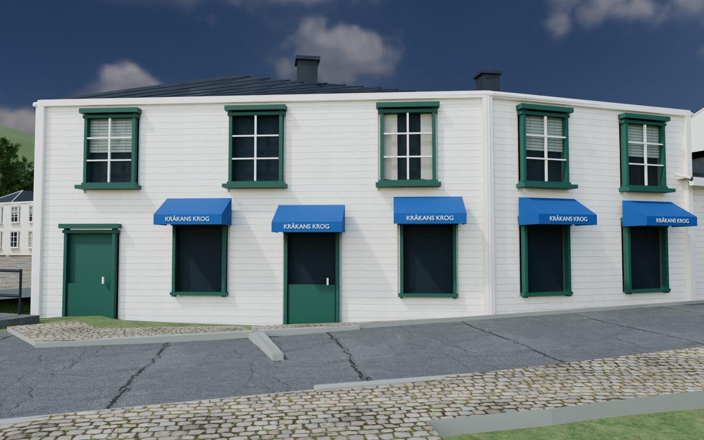
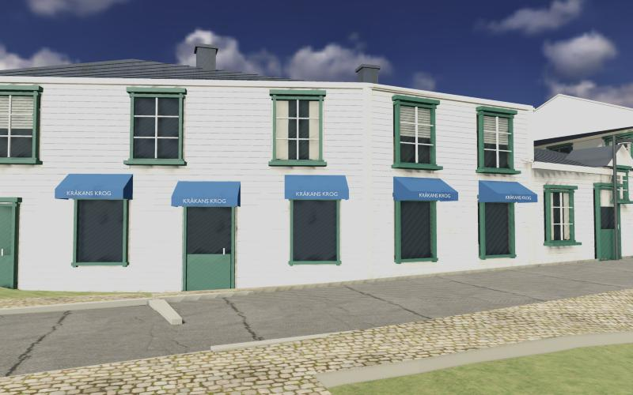
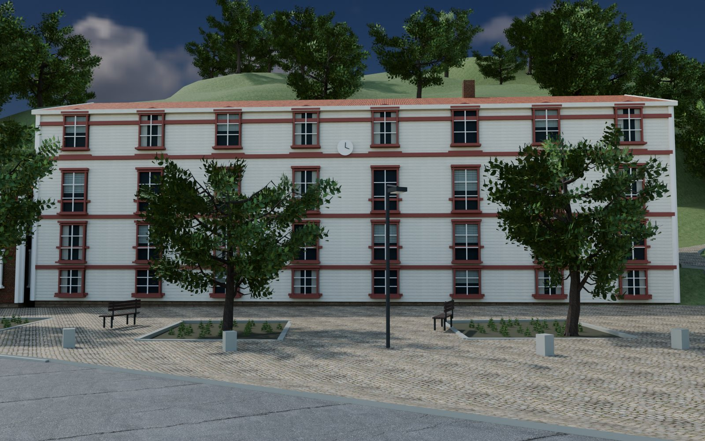
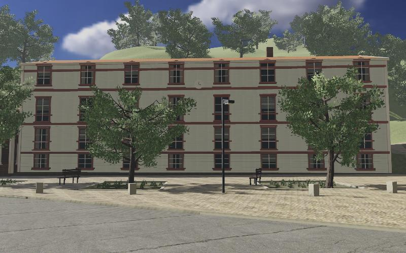
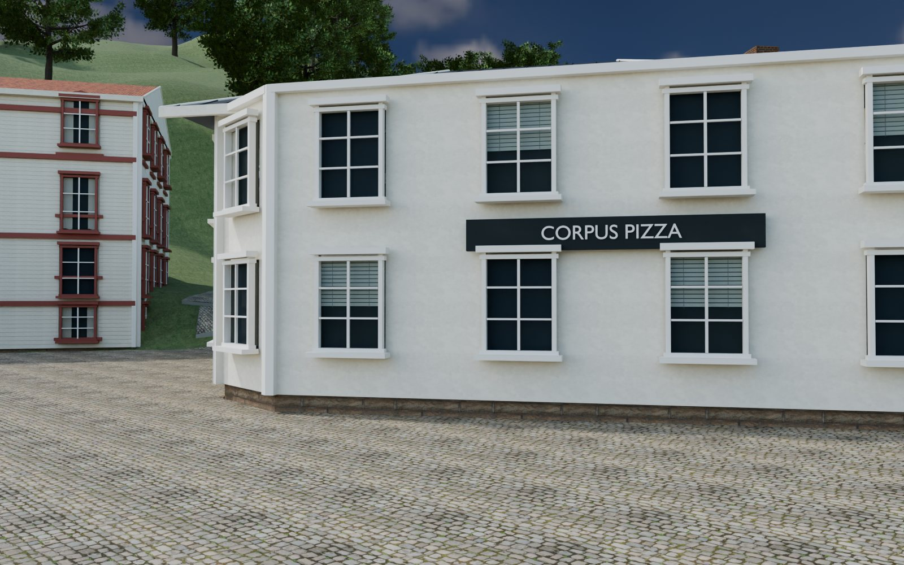
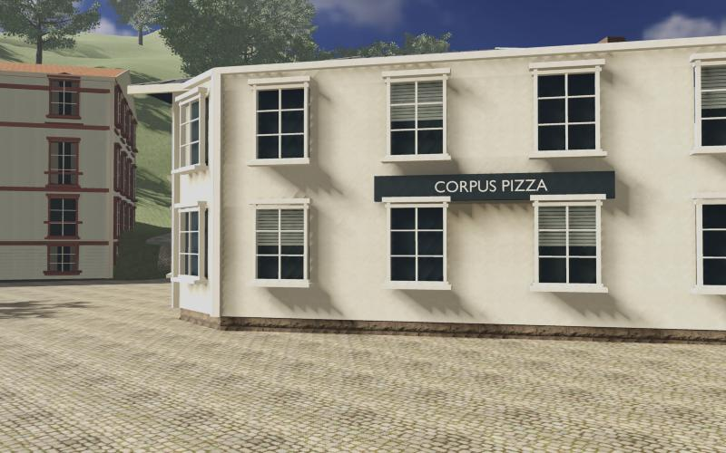
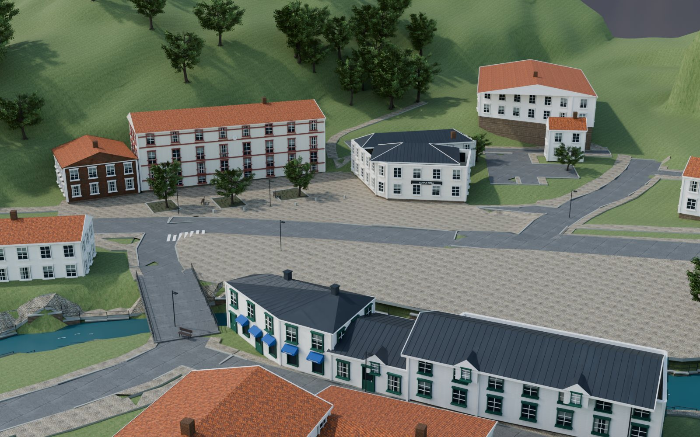
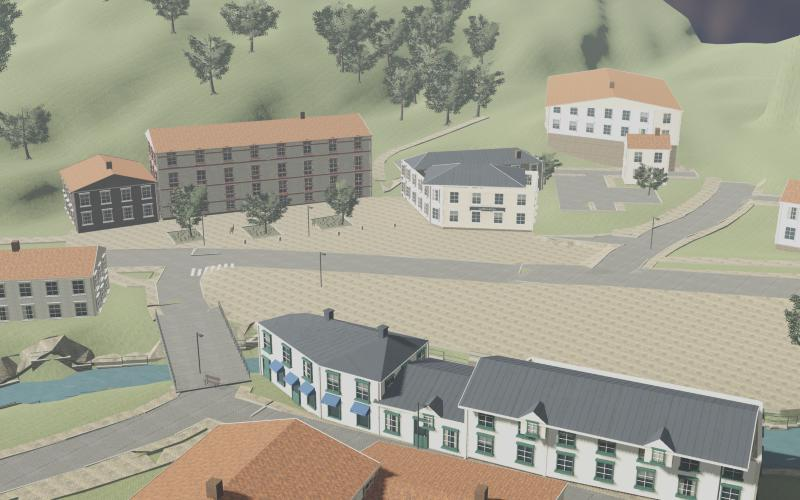

# Resultat — Gamla torget, första innehålls- och motorprovet (2026-10-29)

Byggt av ChatGPT Codex (Blender-innehåll, Godot-projekt, ~14–18) och slutfört av Claude Code
(import, ombake, panelfix, mobilexport, ~18:30–19:45). Frågan i `BRIEF.md`: *kan ett litet
utsnitt av Kvarnbyn byggas med riktig innehållsproduktion i Blender och behålla sin karaktär
när samma modeller visas i ett spelbart webbprov?*

## Svar så långt

**Mätbart: ja.** Samma Blender-modeller körs i Godot i webbläsaren med bakat ljus, 120 bilder/s
på en M5, 51 MB data för telefon. **Visuellt: Joels bedömning återstår**, helst på telefonen.

## Jämförelse Blender (Cycles) mot Godot webb (WebGL 2) från samma vy

| Vy | Blender | Godot i webbläsaren |
|---|---|---|
| Kråkans krog |  |  |
| Gamla torget / Musikskolan |  |  |
| Corpus |  |  |
| Överblick |  |  |

Före panelfixen hade Musikskolans fasad bruna strimmor i Godot: `evidence/godot_webb_torget_FORE_bradfix.jpg`.

## Mätningar

| | Värde |
|---|---|
| Scen | 381 objekt, 198 meshar, 692 k trianglar (Blender) |
| Ljusbake | 165 statiska modeller, 46 s (Vulkan på M5), 0,5 m texel, 2× på Kråkan/Corpus/Musikskolan, ljuskarta 18 MB |
| Webb för telefon (`Webb mobil`, ETC2/ASTC) | `index.pck` 50,5 MB (37,8 MB gzip) + `index.wasm` 39,5 MB (10,1 MB gzip) |
| Webb för dator+telefon (`Webb`, båda texturformaten) | `index.pck` 87 MB |
| Codex första webbexport (2k-texturer, 0,25 m bake) | `index.pck` 165 MB |
| I webbläsaren (Chromium, M5, 1280×800) | 120 fps, 337 draw calls, 852 k renderade trianglar, scen laddad 0,47 s efter motorn |
| Kontroller (headless) | går över 20 cm kantsten, stannar vid vägg, 1,65 m ögonhöjd, paus stoppar rörelse |
| Telefon | **ej provat** |

## Fel som hittades och rättades i slutförandet

1. **Hjältehusens dubbla ljuskartsupplösning fungerade aldrig**: `import_world.gd` satte
   `lightmap_texel_scale`, som inte finns i Godot 4.7 (rätt: `gi_lightmap_texel_scale`).
2. **Strimmor på panelfasader**: varje bräda var en egen låda på 16,5 cm, alltså under en
   ljuskartstexel. Brädorna ligger nu i egna `<hus>_Boards`-objekt som Godot belyser dynamiskt
   (sol med realtidsskuggor + ljusprober); väggen bakom har kvar ljuskartan.
3. **För stor webbexport**: ny preset med bara telefonformat (ETC2/ASTC) och 1k-texturer.

## Kvar att bedöma eller göra

- **Joel**: ser det ut som Kvarnbyn? Fungerar det på telefonen (fps, värme, laddtid)?
- Musikskolans fasad är gråare i Godot än i Blender (skuggsida, indirekt ljus från prober).
- Panelbrädornas indirekta ljus är grovt (prober med 4 underdelningar).
- Bergmaterialet `rock_01` är hämtat men inte använt.
- Punktmolnsprovet (takformer, träd) väntar på att Joel sätter `LM_USER`/`LM_PASS`.
- Hosting för telefon utanför hemnätet.

## Bygga om

```sh
v2/poc/torget/rebuild.sh              # Blender → GLB → Godot-import → bake (~1 min fönster) → webb (~2 min)
python3 -m http.server 8790 --directory v2/poc/torget/web-mobil
```
